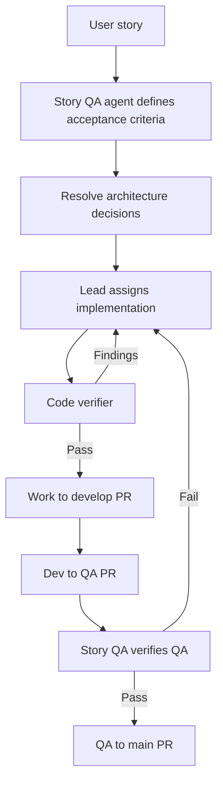

# Project workflow

One Angular build serves both markets. Follow [AGENTS.md](AGENTS.md) and accepted [ADRs](docs/adr/). Story QA and the lead must read [SCOPE.md](SCOPE.md) before defining or assigning work.

| Step | Responsibility and evidence |
| --- | --- |
| Define | Story QA uses the [QA skill](skills/insurance-qa/SKILL.md) to define criteria in `docs/specs/` and bring unresolved behavior to the owner. |
| Decide | The ADR author uses assessment and project context to draft or reuse ADRs. The owner accepts proposals or returns them for revision. |
| Delegate | The lead reads the flow, ADRs, architecture, and folders. Split by dependency and assign scoped context, tests, and models by risk and complexity. |
| Implement | Implementers use the [development skill](skills/insurance-development/SKILL.md) and report the diff, criterion coverage, and check results. |
| Verify code | An independent verifier uses the QA skill to check behavior, code quality, and folder placement. Record findings and verified fixes in `docs/reviews/`. Open the work-to-`develop` PR after verification passes. |
| Promote and test | After a human merges into `develop`, open `develop` → `qa`. After merge, Story QA uses the QA skill against the deployed revision and records results in `docs/qa/`. Route failures through development again. |
| Release | Open `qa` → `main` only after QA passes. Require CI builds and relevant automated tests on each PR. Record the QA-tested revision and rerun affected checks if the release PR changes it. Humans review and merge after checks pass. |

Aim for 100–500 changed code lines per session in independently verifiable chunks. Normally stay within 1,000. Larger changes, such as 1,100, are acceptable when splitting hurts verification. Record why. Follow [agent definitions](docs/agents.md). Record actual models and link the story, spec, ADRs, code, tests, fixes, QA verdict, and unedited session exports.

With five developers, assign story ownership and coordinate shared changes. Humans own merges. [ADR 002](docs/adr/002-conversation-led-planning.md) records planning adjustments.
