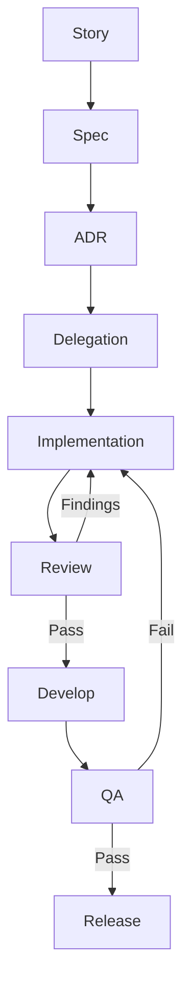

# Project workflow

[Scope](SCOPE.md) · [Rules](AGENTS.md) · [ADRs](docs/adr/). [Roles](docs/agents.md) · [Handoffs](docs/story-records.md)

| Step | Purpose | AI | Tool, model, role or skill | Artifact | Human decision and return path |
| --- | --- | --- | --- | --- | --- |
| Spec | Derive verifiable criteria from the story | Yes | Codex GPT-6.2 Sol, Story QA, [QA skill](skills/insurance-qa/SKILL.md) | [Specs](docs/specs/) | Owner approves the revision or returns ambiguous criteria to Story QA. |
| ADR | Resolve architecture and content boundaries | Yes | Codex GPT-6.2 Sol, ADR author, [story skill](skills/insurance-story/SKILL.md) | [ADRs](docs/adr/) | Owner accepts the decision or returns it to the author. |
| Delegate | Assign work by dependencies and risk | Yes | Codex GPT-6.2 Sol, lead and scoped subagents | [Session index](docs/agent-sessions.md) | Owner authorizes scope and changes. Lead replans rejected assignments. |
| Implement | Build and test through the real entry points | Yes | Codex GPT-6.2 Sol, CMS and Angular implementers, [development skill](skills/insurance-development/SKILL.md) | `cms/src/`, `frontend/src/`, [browser test](frontend/e2e/quote-wizard.mjs) | Owner decides business behavior. Lead returns deviations to implementers. |
| Review | Verify criteria independently and retest fixes | Yes | Codex GPT-6.2 Sol, verifier, QA skill | [Reviews](docs/reviews/) | Lead sends findings back. Maintainer reviews CI and the PR before merging into develop. |
| QA | Test published fixtures on the deployed revision | Yes for PR checks. Deployed run pending. | Codex GPT-6.2 Sol, Story QA, QA skill | [QA verdict](docs/qa/US-01-03.md) | Maintainer approves promotion. Story QA sends failures to the lead. |
| Release | Review the QA-tested revision and CI | No for merge decisions | GitHub, human reviewer | GitHub promotion PR | Maintainer merges after QA and CI, or returns the revision for fixes. |

Codex shares repository context across scoped agents and runs builds and browser checks. Humans approve business rules and releases because they own product behavior and risk.

PR #9 checks exposed empty select options and duplicate active plan keys. PR #10 moved those checks into Strapi publication. The owner replaced mock landing fixtures with live Strapi. With five developers, assign story owners and coordinate shared contracts. Target 100–500 changed lines. Explain larger increments.
